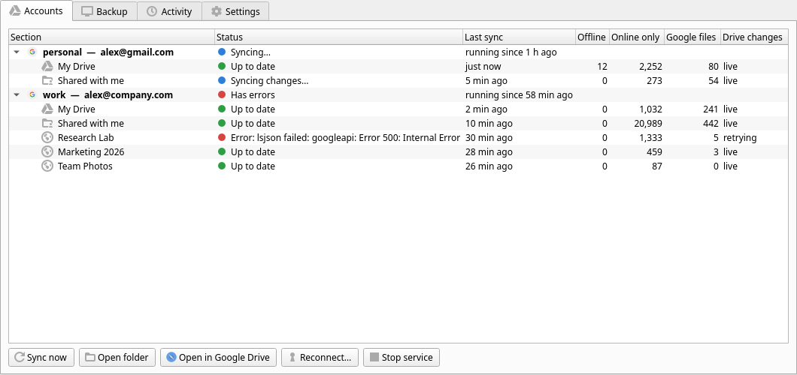
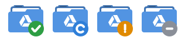
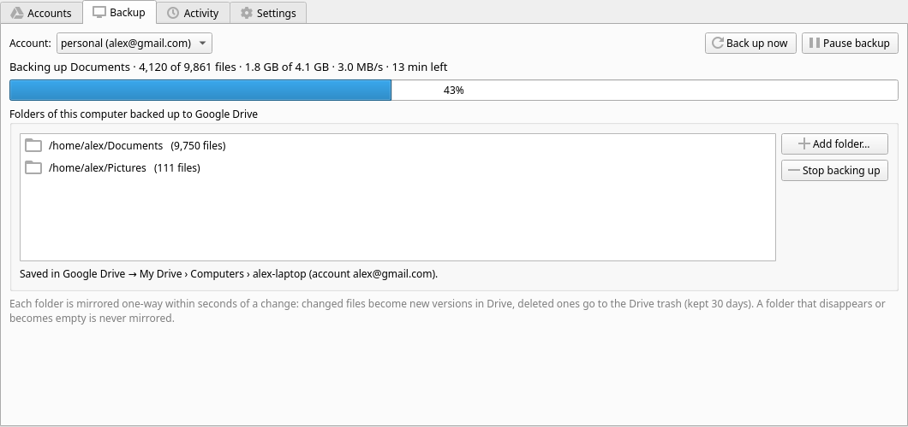

# gdrive-od — Google Drive on demand for Linux

Google Drive for the KDE Plasma desktop (Dolphin), in the style of OneDrive's "Files On-Demand":
every file in your Drive appears in a local folder, but a file only takes disk space once you open
it or ask to keep it offline. Changes sync both ways within seconds, several Google accounts can live
side by side, Google Docs open in the right browser profile, and folders of your computer can be
backed up to Drive.



## Contents

- [Features](#features)
- [How it works](#how-it-works)
- [Requirements](#requirements)
- [Installation](#installation)
- [Connecting Google accounts](#connecting-google-accounts)
- [Daily use](#daily-use)
- [Sections: My Drive, Shared with me, Shared drives, Computers](#sections-my-drive-shared-with-me-shared-drives-computers)
- [Backing up folders of this computer](#backing-up-folders-of-this-computer)
- [The Google Drive app](#the-google-drive-app)
- [Commands](#commands)
- [Configuration](#configuration)
- [Files and locations](#files-and-locations)
- [Safety](#safety)
- [Troubleshooting](#troubleshooting)
- [Uninstalling](#uninstalling)
- [Development](#development)
- [Limitations](#limitations)
- [License](#license)

## Features

- **Files on demand.** Files you haven't downloaded are tiny placeholders (`report.pdf.gdcloud`).
  Double-click one and it downloads and opens. Right-click › Google Drive › *Make available
  offline* or *Free up space* moves files (or whole folders) between online-only and offline.
  Folders can be set to *always keep offline*.
- **Two-way, near-instant sync.** Your changes are seen immediately (inotify) and uploaded about 2 s
  after the application saves the file. Changes made in Drive arrive within about 15 s (Drive
  Changes API). Renames and moves stay renames and moves on both sides, including whole folders,
  which keep their sharing.
- **Several Google accounts**, each in its own folder, each opening Google Docs, Sheets and
  Slides in the browser profile where that account is signed in.
- **Google files with their own icons** (`.gdoc`, `.gsheet`, `.gslides`, `.gform`, `.gdraw`,
  `.gmap`, …). They open the document's editor in the browser.
- **The Drive website's structure:** *My Drive*, *Shared with me*, every *Shared drive* you belong
  to, and *Computers*.
- **Backups** of folders of your computer (Documents, Pictures, …) to Google Drive, mirrored
  one-way within seconds of a change.
- **Dolphin integration:** status tags (`Offline`, `Online only`, `Google file`), a *Google Drive*
  context menu, and an entry per account in the Places panel.
- **A tray app** with status, backup progress, recent activity and settings.
- **Safety first:** deletions go to the Drive trash or your local trash, mass deletions stop and
  ask, conflicts keep both versions, and an empty or missing folder is never mirrored as
  "delete everything".

## How it works

```
 Dolphin / your apps                    gdrive-od daemon (one per Google account)            Google Drive
 ───────────────────    inotify     ┌──────────────────────────────────────────────┐   rclone   ─────────────
 ~/GoogleDrive/Work/  ────────────▶ │ My Drive ─┐                                  │ ◀────────▶ My Drive
   My Drive/          ◀──────────── │ Shared with me ─┼─ 3-way merge (Drive, last  │            Shared with me
   Shared with me/      placeholders│ Shared drive A ─┤   sync, disk) per section  │ ◀──────── Changes API
   Shared drives/A/     downloads   │ Shared drive B ─┘   + SQLite state           │  (every 15 s)
   Computers/this-pc/ ─────────────▶│ Backup (rclone sync) ───────────────────────▶│ ─────────▶ My Drive/Computers/
                                    │ status file ──▶ tray app                     │
                                    └──────────────────────────────────────────────┘
```

- **rclone is only the transport.** gdrive-od lists, uploads, downloads, moves and deletes
  through rclone, and keeps its own state per section in SQLite: what was last synced, so it can
  tell your change from Drive's change from a conflict.
- **Placeholders** are small text files with the file's Drive ID, so they survive moves and
  renames. Google Docs are small JSON link files.
- **Live sync:** inotify reports local changes, and the Drive Changes API reports remote ones.
  Only the affected folders are compared ("targeted sync"). A full comparison still runs at
  start and every 30 minutes as a safety net.
- Each Google account runs as one **systemd user service**, `gdrive-od@NAME`.

## Requirements

- Linux with **KDE Plasma** (Dolphin) for the full experience. Syncing works on any desktop; the
  context menu, Places entries and status tags are KDE features.
- **Python ≥ 3.11.** The sync tool uses only the standard library.
- **rclone ≥ 1.60** (current versions recommended).
- `notify-send` (libnotify) for desktop notifications, and `xdg-utils`.
- For the tray app: **PySide6** (Qt for Python). Syncing doesn't need it.
- A **Google OAuth client** of your own (free, about 5 minutes). See
  [docs/google-oauth-client.md](docs/google-oauth-client.md).

## Installation

```bash
git clone <this repository> gdrive-od
cd gdrive-od
./install.sh
```

The installer:

1. Installs the packages: rclone, Python, libnotify, xdg-utils, and PySide6 for the app. It
   supports `pacman` (Arch, CachyOS, Manjaro), `apt` (Debian, Ubuntu), `dnf` (Fedora) and
   `zypper` (openSUSE), and asks before using `sudo`.
2. Checks Python and rclone versions. If your distribution's rclone is too old, it shows how to
   get the current one.
3. Copies `gdrive-od` and `gdrive-od-ui` to `~/.local/bin`.
4. Sets up the desktop: file types and icons, the "Open" handler, the Dolphin menu, the systemd
   unit, the "Google Drive" launcher, and starting the tray icon at login.
5. Offers to connect your first Google account. That step needs the OAuth client JSON; see the
   next section.

| Option | Effect |
|---|---|
| `--no-deps` | Don't install packages (you already have them). |
| `--prefix DIR` | Install the programs into `DIR/bin` (default `~/.local`). |
| `--no-ui` | Skip the tray app. |
| `--no-account` | Don't offer to connect an account at the end. |
| `-y`, `--yes` | Answer yes to the questions. |
| `--uninstall` | Remove everything the installer added (see [Uninstalling](#uninstalling)). |

To update, `git pull` and run `./install.sh --no-deps` again. Then restart the services:
`systemctl --user restart 'gdrive-od@*'`.

## Connecting Google accounts

1. **Create your OAuth client once** and download its JSON. Follow
   [docs/google-oauth-client.md](docs/google-oauth-client.md). While the app is in *Testing*
   mode, add every Google account you want to sync as a test user.
2. **Add each account:**

   ```bash
   gdrive-od add-account personal --email you@gmail.com --client ~/Downloads/client_secret_….json
   gdrive-od add-account work     --email you@company.com
   ```

   For each account this:
   - finds the browser profile where that account is signed in (Chrome, Chromium, Brave, Edge,
     Vivaldi), else uses your default browser;
   - opens Google's consent page there. Choose the account, click *Continue* past "Google hasn't
     verified this app", tick **"See, edit, create and delete all of your Google Drive files"**,
     and click *Continue*;
   - creates the rclone remote (`gdrive-NAME`) and adds `[accounts.NAME]` to the config;
   - creates the folders and the Places entry, runs the first sync (placeholders only, nothing is
     downloaded), and starts the `gdrive-od@NAME` service.

   Options: `--local DIR` (default `~/GoogleDrive/Name`), `--browser "firefox -P work"`,
   `--backup ~/Documents` (repeatable), `--flat` (My Drive only, without sections),
   `--remote NAME`, `--reuse-remote`, `--no-sync`, `--no-service`.

3. **Every 7 days** (only while the OAuth app is in *Testing* mode) Google ends the sign-in. You
   get a notification. Reconnect with Dolphin right-click › Google Drive › **Reconnect account**,
   the app's **Reconnect…** button, or `gdrive-od reconnect NAME`.

## Daily use

| You see or do | What happens |
|---|---|
| `report.pdf.gdcloud` | An online-only placeholder: a few bytes, with the real size shown in Dolphin's *Comment* column. |
| Double-click a placeholder | It downloads, replaces the placeholder, and opens. |
| `Plan.gdoc`, `Budget.gsheet`, `Deck.gslides`, `Survey.gform`, … | Google files with their own icons; they open the editor in that account's browser profile. |
| Right-click › Google Drive › **Make available offline** | Downloads. On a folder, new files in it also arrive downloaded. |
| Right-click › Google Drive › **Free up space** | Back to placeholders (pending edits are uploaded first). |
| Right-click › Google Drive › **Open in Google Drive** | Opens the item on drive.google.com, in the right profile. |
| Right-click › Google Drive › **Sync now** | A full sync of all accounts. |
| Edit, create, rename, move, delete | Synced both ways within seconds; deletions go to the trash (Drive and local). |
| `name (conflict laptop 2026-10-04 1012).ext` | Both sides changed the same file: your version is kept under this name, and both end up in Drive. |

**Status in Dolphin:** in *Details* view, right-click a column header and enable **Tags** (and
optionally **Comment**). Items are tagged `Offline`, `Online only` or `Google file`; your own tags
are kept. If the Tags column stays empty, enable *File Search* for that folder in System Settings.

**Deleting:** deleting a file, placeholder or Google file link here moves the item to the **Drive
trash** (Google keeps it 30 days). To free disk space without deleting, use *Free up space*.
Something deleted on drive.google.com is moved to your **local trash**.

## Sections: My Drive, Shared with me, Shared drives, Computers

With `sections = true` (the default for `add-account`), an account folder mirrors the Drive
website:

```
~/GoogleDrive/Work/
├── My Drive/                two-way sync
├── Shared with me/          what other people shared with you
├── Shared drives/<name>/    one folder per Shared drive you belong to
└── Computers/<this PC>/     links to the folders backed up from this computer
```

- **Shared with me:** your edits go up wherever the owner lets you edit, and new files can be added
  inside shared folders you can write to. You can't delete or move items you **don't own** from
  here: they come back, with a notification. New items at the top level stay only on this
  computer, because Drive has no folder there to put them in.
- **Shared drives:** two-way sync, limited by your role in each drive. Anything Google refuses is
  either put back (deletions) or kept only on this computer (uploads), and isn't retried until
  you change it. Shared drives you join later appear within an hour, or right away with *Sync now*.
- **Computers:** Google lets only its own *Drive for desktop* app (Windows, macOS) create entries
  on Drive's *Computers* page. gdrive-od therefore keeps backups in **My Drive › Computers ›
  <this PC>**, and the local *Computers* folder links to the backed-up folders. That folder is left
  out of My Drive's sync, so nothing appears twice.
- Choose what to show in the app's **Settings**, or in the config (`shared_with_me`,
  `shared_drives`).

An account created without sections (`--flat`) can switch later: set `sections = true` and restart
its service. The synced files move into `My Drive/` (a rename; nothing is downloaded again).

## Backing up folders of this computer

Add folders in the app (**Backup** tab › **Add folder…**), with
`gdrive-od add-account … --backup ~/Documents`, or in the config:

```toml
[accounts.personal]
backup = ["~/Documents", "~/Pictures"]
backup_name = "my-laptop"        # optional; default: this computer's name
```

- Each folder is mirrored **one-way** to `My Drive/Computers/<backup_name>/<folder>`. Only the
  changed folder is processed, within seconds of a change, and a full check runs at start and
  every 30 minutes.
- A changed file becomes a **new version** of the same Drive file (Drive keeps previous versions).
  A deleted file goes to the **Drive trash**.
- If a backed-up folder **disappears or becomes empty** (an unplugged disk, say), its backup is left
  untouched and you get a notification. A single run never deletes more than half of a folder's
  files.
- Pause, resume or start a backup from the app, the tray menu, or
  `gdrive-od backup pause|resume|now [ACCOUNT]`. Changes made while paused are backed up on resume.
- **To restore**, download the files from drive.google.com, or with
  `rclone copy gdrive-NAME:Computers/<backup_name>/<folder> <destination>`.
- The first backup of a large folder takes a while: Drive accepts roughly one new file per
  second, plus the time your upload bandwidth needs. Progress is shown in the app.

## The Google Drive app

`gdrive-od-ui` puts an icon in the system tray, and opens a window when you click it. Find it as
**Google Drive** in the application menu.



The tray badge shows the state: ✓ up to date · ↻ syncing or backing up · ! needs attention (an
error, or you need to sign in again) · – not running. Hover for a summary; right-click for *Open
folder*, *Sync now*, *Pause backup* and *Reconnect*.

| Tab | What it shows / does |
|---|---|
| **Accounts** | Every account and section: state, last sync, files offline / online-only / Google files, whether Drive changes arrive live. Sync now, Open folder, Open in Google Drive, Reconnect, Start/Stop service. |
| **Backup** | Live progress (files, size, speed, time left), the backed-up folders (*Add folder…*, *Stop backing up*), *Pause/Resume*, *Back up now*. |
| **Activity** | Recent uploads, downloads, deletions, conflicts and items put back. Double-click a row to show it in Dolphin. |
| **Settings** | Per account: Shared with me, which Shared drives, how often to check Drive, start at login. Also: show the tray icon at login. |



The app only displays and controls the sync services, which run on their own. Closing it (or
*Quit*) doesn't stop syncing. Settings changes are written to the config file without touching your
comments, and the account's service restarts to apply them.

## Commands

| Command | What it does |
|---|---|
| `gdrive-od add-account NAME --email ADDRESS [--client FILE] …` | Connect a Google account (see above). |
| `gdrive-od sync [ACCOUNT…] [--force]` | Full sync now (all accounts by default). `--force` overrides the safety stops. |
| `gdrive-od daemon ACCOUNT` | Live sync of one account (what the systemd service runs). |
| `gdrive-od pin PATH…` / `unpin PATH…` | Make available offline / free up space. |
| `gdrive-od open PATH` | Open a placeholder (downloads it) or a Google file link (opens the browser). |
| `gdrive-od web PATH` | Open the item, section or account in Google Drive's website. |
| `gdrive-od status PATH…` | Offline / online-only / Google-file counts. On an account folder, every section. |
| `gdrive-od reconnect [ACCOUNT\|PATH…]` | Sign in to Google again (expired or revoked token). |
| `gdrive-od backup pause\|resume\|now [ACCOUNT…]` | Control this computer's backup. |
| `gdrive-od setup-desktop` | (Re)install the file types, icons, Dolphin menu, systemd unit and launcher. |
| `gdrive-od-ui [--tray]` | The tray app; `--tray` starts without opening the window. |

Services: `systemctl --user {start|stop|restart|status} gdrive-od@NAME`. `systemctl --user reload
gdrive-od@NAME` triggers a full sync. Logs: `journalctl --user -fu gdrive-od@NAME`. Add `-v` to any
command for debug output.

## Configuration

`~/.config/gdrive-ondemand/config.toml` holds one block per account. `add-account` writes it for
you; edit it by hand or through the app's Settings.

```toml
[accounts.work]
remote   = "gdrive-work:"                  # rclone remote (optionally with a subfolder: "gdrive-work:Projects")
local    = "~/GoogleDrive/Work"
email    = "you@company.com"
browser  = ["google-chrome-stable", "--profile-directory=Profile 1"]
sections = true
# shared_with_me     = true
# shared_drives      = ["Research Lab", "Team Photos"]   # default "all"; [] for none
# backup             = ["~/Documents"]
```

| Key | Default | Meaning |
|---|---|---|
| `remote` | *(required)* | rclone remote of type `drive`, optionally with a subfolder. |
| `local` | *(required)* | Folder on this computer. |
| `email` | `""` | Google account; added to links as `authuser=` so the right login is used. |
| `browser` | `["xdg-open"]` | Command that opens Google Docs and Drive links. In Chrome, open `chrome://version` and take the last part of "Profile Path" for `--profile-directory`. Firefox: `["firefox", "-P", "work"]`. |
| `sections` | `false` (`add-account`: `true`) | Show My Drive / Shared with me / Shared drives / Computers as folders. |
| `shared_with_me` | `true` | Show the *Shared with me* section. |
| `shared_drives` | `"all"` | Which Shared drives to show: `"all"`, a list of names, or `[]`. |
| `backup` | `[]` | Folders of this computer to back up. |
| `backup_name` | host name | Folder name under `My Drive/Computers/`. |
| `poll_interval` | `15` | Seconds between checks for changes in Drive. |
| `full_sync_interval` | `1800` | Seconds between full comparisons while live sync works. |
| `interval` | `120` | Seconds between full comparisons when live sync isn't available. |
| `settle` | `10` | Seconds a file must be unchanged before upload, if it is still open for writing. |
| `max_delete_pct` | `50` | Safety stop: never delete more than this % of the files in one sync (min. 25 files). |
| `rclone_args` | `[]` | Extra rclone flags, e.g. `["--drive-acknowledge-abuse"]`. |

Environment variables for special setups and tests: `GDOD_CONFIG` (config file), `GDOD_STATE`
(state folder), `GDOD_RCLONE` (rclone binary), `GDOD_NO_NOTIFY=1` (no notifications).

## Files and locations

| Path | Content |
|---|---|
| `~/.local/bin/gdrive-od`, `gdrive-od-ui` | The programs. |
| `~/.config/gdrive-ondemand/config.toml` | Your accounts. |
| `~/.config/gdrive-ondemand/oauth-client.json` | Your OAuth client (mode 600). |
| `~/.config/rclone/rclone.conf` | rclone remotes and their tokens. |
| `~/.local/state/gdrive-ondemand/` | Per section: `NAME.db` (sync state, SQLite), `NAME.lock`. Per account: `NAME.status.json` (for the app), `NAME.drives.json`, `NAME.backup.json`, `NAME.backup-paused`. |
| `~/.config/systemd/user/gdrive-od@.service` | The service template. |
| `~/.local/share/kio/servicemenus/gdrive-od.desktop` | Dolphin's *Google Drive* menu. |
| `~/.local/share/mime/packages/gdrive-ondemand.xml` | File types for placeholders and Google files. |
| `~/.local/share/applications/gdrive-od-*.desktop` | Open handler and the app launcher. |
| `~/.config/autostart/gdrive-od-ui.desktop` | Tray icon at login. |

**Placeholder format:** a text file `<name>.gdcloud` with `id:` and `path:` lines, plus the extended
attributes `user.gdrive.id` and `user.gdrive.path`. **Google file links:** JSON with
`{"gdrive_od": 1, "account": …, "id": …, "type": …, "url": …}`.

## Safety

- **Nothing is deleted for good.** Deletions go to the Drive trash (30 days) or to your local trash.
- **Mass-deletion stop:** a sync that would delete more than `max_delete_pct` of the files (and more
  than 25) stops and notifies you. Check what happened, then `gdrive-od sync --force NAME` if it was
  intended.
- **Empty listings are never trusted.** If Drive returns nothing, or the local folder is suddenly
  empty (an unmounted disk, a deleted folder) while files were synced before, the sync refuses.
  Backups do the same for a vanished or empty source folder.
- **Conflicts keep both versions:** `name (conflict host date).ext`.
- **Files being saved are left alone.** A path whose events are still arriving (an editor's
  "safe save" removes the file for a moment) is never taken as deleted.
- **Shared content:** items you don't own are never deleted or moved from *Shared with me*.
- **Restarts are safe:** stopping a service finishes the current step. An interrupted transfer is
  redone on the next sync.

## Troubleshooting

| Symptom | What to do |
|---|---|
| Notification "sign-in expired" / `invalid_grant` in the logs | `gdrive-od reconnect NAME` (expected every 7 days while the OAuth app is in Testing mode). |
| "Access blocked" on the consent page | Add the account as a test user of your OAuth app; for school or company accounts the admin may block outside apps. See [docs/google-oauth-client.md](docs/google-oauth-client.md#troubleshooting). |
| "Safety stop: this sync would delete …" | Check the folder. If intended: `gdrive-od sync --force NAME`. |
| "The local folder … is empty but files were synced before" | Is the disk mounted / the folder in place? If you really want Drive emptied too: `--force`. |
| Nothing syncs | `systemctl --user status gdrive-od@NAME`, then `journalctl --user -u gdrive-od@NAME -n 100`. |
| Changes from Drive are slow | The app's *Drive changes* column says `retrying`: network or Google API problem; it retries on its own and falls back to a full comparison every `interval` s. |
| "inotify watch limit reached" | Raise it: `echo fs.inotify.max_user_watches=524288 \| sudo tee /etc/sysctl.d/90-inotify.conf && sudo sysctl --system`. |
| Dolphin shows no Tags / Google Drive menu | Enable File Search for the folder; run `gdrive-od setup-desktop` and restart Dolphin. |
| Google Docs open in the wrong browser profile | Fix `browser` in the config (see [Configuration](#configuration)). |
| Two files with the same name in one Drive folder | Drive allows it but a folder can't: run `rclone dedupe gdrive-NAME:path`. |
| The app says "Not running" | Start the service from the app or `systemctl --user start gdrive-od@NAME`. |

## Uninstalling

```bash
./install.sh --uninstall
```

This stops and disables the services, and removes the programs, file types, icons, Dolphin menu,
systemd unit, launcher and autostart entry. It **keeps** your Drive folders, the config, the sync
state and the rclone remotes. Delete those yourself if you want, and remove the *Google Drive ·…*
Places entries in Dolphin (right-click › Remove). To also revoke gdrive-od's access to an account,
visit <https://myaccount.google.com/permissions>.

## Development

```
gdrive-od            the sync tool and services (single file, Python standard library only)
gdrive-od-ui         the tray app (PySide6); imports gdrive-od as a module
install.sh           installer / uninstaller
docs/                OAuth client guide, screenshots
tests/               pytest suite
```

```bash
python -m pytest tests            # needs pytest and rclone; PySide6 for the app tests
```

The tests run against an rclone **local-path remote** (a plain folder) in a temporary
directory, never against your real Drive or desktop files:

- `tests/fake_rclone.py` wraps the real rclone so a folder behaves like Drive: inode numbers act
  as file IDs, `*.desktop` files act as Google Docs, and it can simulate owners, permission
  refusals and the OAuth sign-in. It logs every call, so tests can count rclone calls.
- The Drive Changes API is faked, both in-process and with a small HTTP server.
- The app is rendered with `QT_QPA_PLATFORM=offscreen`.

## Limitations

- **Tested on** CachyOS (Arch) with KDE Plasma 6, rclone 1.75 and Python 3.14. The installer
  also handles apt, dnf and zypper, but those paths haven't been tried yet.
- Each upload or download is one rclone call, so the first sync of many new files (copying a big
  folder in, the first backup) takes about 1–2 s per file.
- Google Docs need an internet connection to open. Chrome's "Docs Offline" helps.
- Placeholders keep the `.gdcloud` suffix, so Dolphin shows a cloud icon rather than the file type.
- Drive allows two items with the same name in one folder; only one of them is synced (use
  `rclone dedupe`).
- Service-account remotes have no live change feed; they fall back to a full comparison every
  `interval` seconds.
- Drive's real *Computers* page can't be written by third-party apps (see
  [Sections](#sections-my-drive-shared-with-me-shared-drives-computers)).

## License

[MIT](LICENSE) © 2026 Esteban Rodriguez
